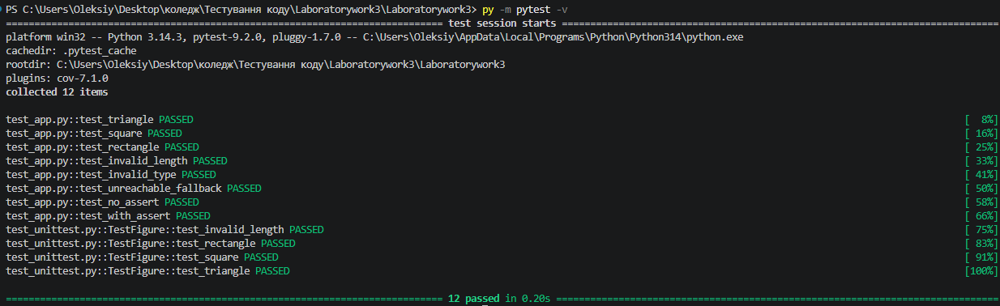
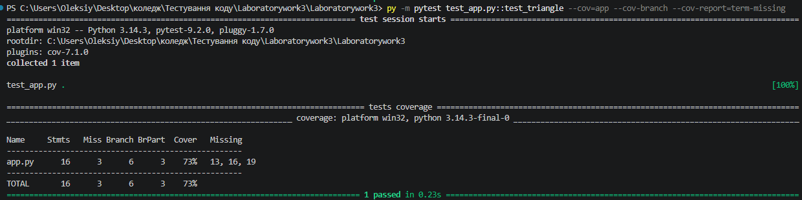
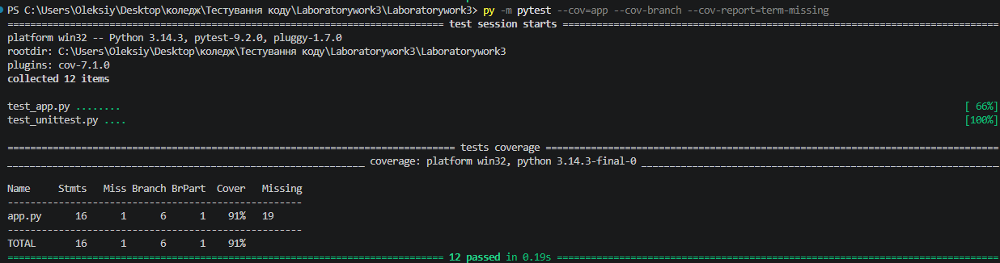
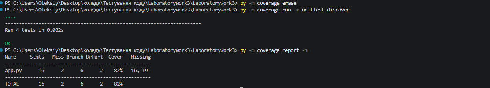
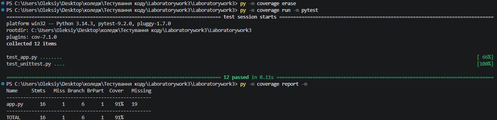
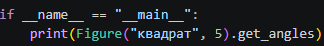
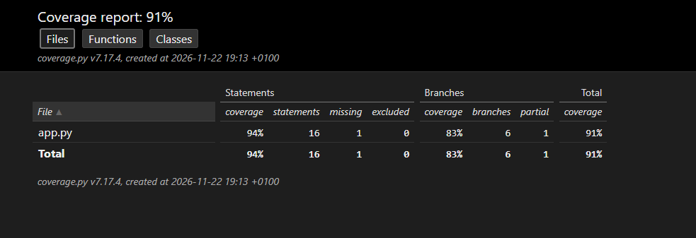
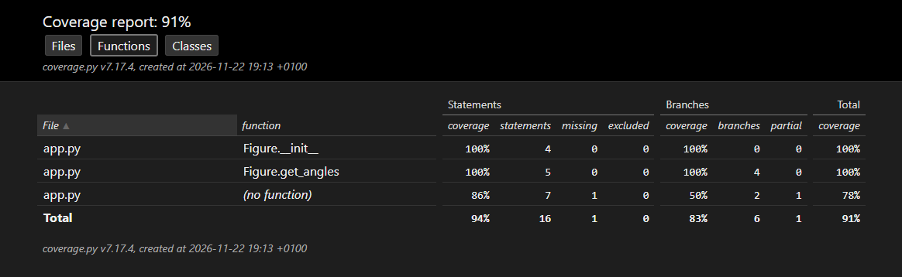

# Laboratorywork3

## Тема: Покриття коду

## Завдання 1: команда запуску тестів

## Завдання 2: покриття до і після додавання тестів
### До:

### Після:

## Завдання 3: Окремі запуски unittest і pytest
### unittest:

### pytest:

## Завдання 4: Використання pragma: no cover

## Завдання 5: HTML та XML звіти

